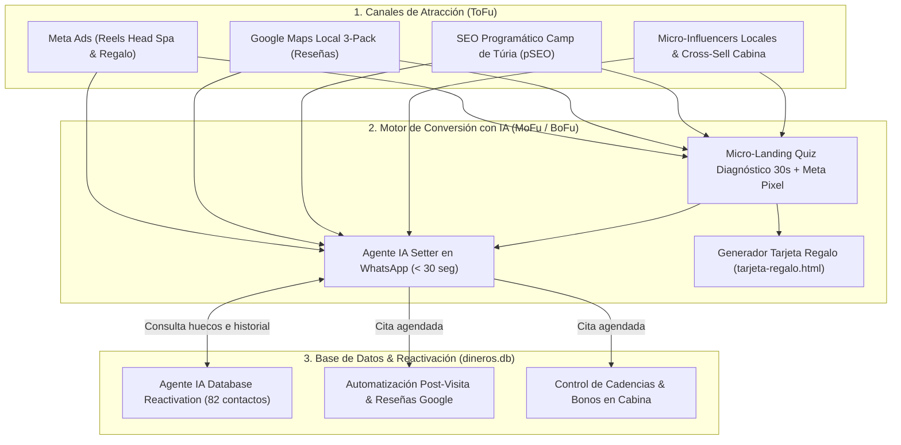

# 🚀 Plan Maestro de Captación de Clientes y Agentes de IA — Llum de Lluna

> [!IMPORTANT]
> **Objetivo Financiero y Operativo**: Pasar de una facturación media de ~800 €/mes (concentrada en un 70%+ en manicuras de ~20 €–25 €) a superar el punto de equilibrio total (**>2.600 €/mes**, cubriendo alquiler de 948,60 €, letra mensual del traspaso de 1.250 € y gastos operativos) mediante la captación de **35 a 40 citas mensuales de ticket alto (60 €–110 €)**: *Rituales de Spa Capilar (Head Spa)*, *Rituales Faciales*, *Combo Facial + Spa Capilar (110 €)*, *Dermapen/Exosomas* y *Fotodepilación IPL*.

---

## 📊 Resumen de Partida y Arquitectura Real (`GitHub Pages` + `Dineros Local`)

* **Ubicación**: C/ General Pastor 19, pta. 1, L'Eliana (Valencia) — Antiguamente *Edurne Azcona Estética Avanzada*.
* **Arquitectura Técnica de tus 3 Sistemas (`GitHub Pages` + `Treatwell` + `Dineros Local`)**:
  1. **`/home/jnavas/llumdelluna` (Pública en GitHub Pages)**: Web 100% estática (HTML/CSS/JS client-side) desplegada vía `git push` bajo `llumdellunaestetica.es`. Coste de servidor: **0 €**.
  2. **Treatwell Connect (`widget.treatwell.es/establecimiento/llum-de-lluna/`)**: Tu **sistema oficial de reservas y calendario vivo 24/7 en la nube**.
     * *Dato financiero crítico (de `dineros.db`)*: Si un cliente nuevo te descubre en el marketplace de Treatwell, te cobran un **25%–35% de comisión**. Pero si reserva a través de tu **enlace directo de Widget (`widget.treatwell.es`)** desde tu web, Instagram, Google Maps o WhatsApp, la comisión de captación es **0%**.
     * *Ventaja operativa*: No necesitas programar ni mantener un motor de calendario en la nube para reservas 24/7, porque el widget de Treatwell ya tiene la disponibilidad real al minuto de Emma y Glohanna.
  3. **`/home/jnavas/dineros` (100% Local en tu PC)**: ERP/CRM privado en Node.js + SQLite ([/home/jnavas/dineros/server.js](file:///home/jnavas/dineros/server.js) y [/home/jnavas/dineros/dineros.db](file:///home/jnavas/dineros/dineros.db)) donde registras contabilidad, ventas realizadas/pendientes, **82 clientas/contactos**, **112 servicios realizados**, escandallo de cabina y seguimiento de leads (`clientes_comunicaciones`).
* **Implicación Clave en el Plan**:
  * **Cierre Dual (WhatsApp + Widget Treatwell 0% Comisión)**: En servicios de 60 €–110 € (Head Spa, Faciales, Dermapen), la gente suele tener dudas previas (o quiere cita compartida / tarjeta regalo) y por eso escribe por WhatsApp, pero muchas otras prefieren mirar huecos a las 23:00 sin hablar con nadie. Combinar la **cualificación en WhatsApp/Quiz** con el **enlace directo al Widget de Treatwell (0% comisión)** elimina el problema del PC apagado y rescata a los leads que dicen *"ya miraré cuándo puedo ir"*.
  * **Fricción detectada en [tratamientos.html](file:///home/jnavas/llumdelluna/tratamientos.html)**: Actualmente, en tu carta web, los servicios que están *"Próximamente"* tienen un botón de WhatsApp al lado, pero **los servicios activos (como el Ritual Capilar de 60 € o el Ritual Facial de 65 €) NO tienen un botón de "Reservar este tratamiento" junto al precio**. Añadir ahí botones directos (Widget Treatwell + WhatsApp con el nombre del servicio) es una victoria inmediata.
* **Diagnóstico del Embudo Actual (Campaña Meta Ads Reel Hair Spa — 60 € / 10 días)**:
  * **Atracción (ToFu) Validada**: 20.000 visualizaciones (CPM 3 €) y ~10 contactos por WhatsApp (**CPL de 6 €/lead**).
  * **Fuga Detectada (MoFu/BoFu)**: Caída del 80%–90% entre la consulta por WhatsApp y la reserva en firme. Los leads preguntan precio/info y dejan de contestar cuando no hay cualificación guiada, anclaje de valor, propuesta de 2 huecos cerrados o enlace directo a tarjeta regalo.

---

## 🗺️ Arquitectura Global del Sistema de Captación



---

## 🛠️ MÓDULO 1: Rescate Inmediato de Leads y Reactivación de las 27 Ex-Clientas del Traspaso
**Prioridad**: 🔥 Máxima (Coste 0 €, retorno potencial en 24h–72h)
**Archivos implicados**: [/home/jnavas/dineros/dineros.db](file:///home/jnavas/dineros/dineros.db) (`clientes_comunicaciones`, `clientes_info`, `whatsapp_plantillas`)

### Paso 1.1: Rescate quirúrgico de los contactos abiertos en `clientes_comunicaciones`
En `dineros.db` hay contactos recientes calientes que preguntaron por el *Head Spa* o tratamientos corporales y quedaron en estado `pendiente`. No se les debe enviar una plantilla genérica, sino un mensaje que haga referencia exacta a su nota registrada, acompañado opcionalmente de un **audio de voz natural de 15 segundos de Emma**:

- [ ] **Yoli** *(Preguntó el 16/11 por un Spa Capilar para su madre, recibió precios y no contestó)*:
  * **Acción**: Enviarle por WhatsApp una imagen de muestra generada en [tarjeta-regalo.html](file:///home/jnavas/llumdelluna/tarjeta-regalo.html) a nombre de su madre.
  * **Guion**: *"¡Hola Yoli! 🌸 Soy Emma de Llum de Lluna. Me he acordado de ti porque me preguntaste por el Spa Capilar para tu madre y acabamos de preparar las Tarjetas Regalo personalizadas en sobre físico (o digital) para Navidad y cumpleaños. Además, si quieres venir con ella, tenéis un 10% de descuento en ambas sesiones. ¿Quieres que te prepare el bono regalo con su nombre sin compromiso?"*
- [ ] **Lauri, Marmores y Random 2** *(Preguntaron el 21/11 por precios/duración/dirección y dijeron "ya os diré")*:
  * **Acción**: Romper la fricción del compromiso con escasez real de agenda y doble alternativa cerrada.
  * **Guion**: *"¡Hola [Nombre]! ✨ Soy Emma. Te escribo rapidito porque estoy cerrando los turnos de cabina de esta semana para el Spa Capilar Japonés y solo me quedan libres el [Día A] a las [Hora A] o el [Día B] a las [Hora B]. Como me preguntaste el otro día, quería avisarte a ti primero por si te cuadra alguno antes de abrirlos en la web. ¿Te viene bien alguno de los dos?"*
- [ ] **Carolina Sanchis** *(61 años, muy interesada el 09/11, llamó y preguntó si había descuento por pelo corto)*:
  * **Acción**: Resolver su objeción del pelo corto transformándola en más tiempo de masaje craneal/cervical.
  * **Guion**: *"¡Hola Carolina! Soy Emma de Llum de Lluna 🌸. Como me comentaste que tienes el cabello corto, quería contarte que en tu caso aprovechamos los minutos que ahorramos en el secado para alargar el masaje relajante craneal, de cuello y hombros bajo el aro de agua tibia, y además te incluimos un detalle de bienvenida en tu primera sesión. ¿Prefieres pasarte por las mañanas o por las tardes?"*
- [ ] **Maca** *(Preguntó el 09/11 por compatibilidad con pérdida de cabello)*:
  * **Guion**: *"¡Hola Maca! Soy Emma. Como me preguntaste por la caída capilar, quería comentarte que antes de empezar el ritual hacemos una valoración del cuero cabelludo para adaptar la oxigenación y el masaje folicular suave sin tracción. Si quieres, pásate 10 minutitos sin coste a que te valore en cabina privada y te explico cómo trabajamos."*
- [ ] **Pastrana** *(Preguntó el 23/11 por teléfono sobre drenaje linfático / masaje relajante)*:
  * **Acción**: Citar para valoración o primera sesión corporal/relajante antes de que se enfríe.

### Paso 1.2: Campaña "Saldo Cargado en Ficha (15 €)" para las 27 Ex-Clientas del Traspaso
De las 28 clientas con `referido_tipo = 'antigua_duena'` en `clientes_info`, las 28 recibieron el mensaje informativo del traspaso, pero **solo 1 ha venido**. El mensaje institucional informa, pero no activa la dopamina de compra.

- [ ] Extraer de `dineros.db` las 27 clientas con `referido_tipo = 'antigua_duena'` que no tienen registros en la tabla `ventas`.
- [ ] Enviarles (en lotes de 5–7 al día por WhatsApp) un **bono nominal con fecha de caducidad** (efecto *aversión a la pérdida*):
  * **Guion**:
    > *"¡Hola {nombre}! ✨ Soy Emma, de Llum de Lluna (el centro de C/ General Pastor 19 donde estaba Edurne, con Glohanna). Como eras clienta de la casa y nos encantaría que vieras cómo han quedado las cabinas privadas y nuestro nuevo Spa Capilar Japonés, **te he dejado activado en tu ficha personal un Bono Regalo de 15 €** para canjear en tu primer Ritual Capilar (60 € → 45 €) o Ritual Facial Renovador (65 € → 50 €) de aquí al 20 de diciembre. ¿Te apetece que te busque un hueco esta semana o la que viene para disfrutarlo?"*
- [ ] Registrar cada envío en `clientes_comunicaciones` con `tipo = 'oferta'` y `servicio = 'Bono Reactivación Traspaso 15€'`.

---

## 💅 MÓDULO 2: Upselling y "Bautismo en Cabina" (De Uñas 22 € → Head Spa / Facial 60 €)
**Prioridad**: 🔥 Alta (Aprovechar el tráfico físico que ya entra cada semana al salón)
**Archivos implicados**: [flyer-bono-regalo.html](file:///home/jnavas/llumdelluna/flyers-y-tarjetas/flyer-bono-regalo.html), [flyer-local-spa-capilar.html](file:///home/jnavas/llumdelluna/flyers-y-tarjetas/flyer-local-spa-capilar.html)

### Paso 2.1: El Protocolo de los "60 Minutos con Glohanna"
Una clienta de manicura semipermanente o refuerzo de grafeno pasa 60 minutos sentada en el local. Ya confía en el centro, ya se ha desplazado hasta L'Eliana y tiene poder adquisitivo.
- [ ] **Apoyo visual en la mesa de manicura**: Colocar el soporte de mostrador ([flyer-local-spa-capilar.html](file:///home/jnavas/llumdelluna/flyers-y-tarjetas/flyer-local-spa-capilar.html)) o una tablet/marco digital reproduciendo en bucle y sin sonido el vídeo del aro de agua del *Head Spa*.
- [ ] **Micro-experiencia gratuita al finalizar las uñas**: Si Emma está libre 5 minutos cuando la clienta termina la manicura, invitarla a entrar a la cabina de Head Spa para enseñarle la camilla japonesa, dejarle oler los aceites esenciales y hacerle un diagnóstico visual rápido del cuero cabelludo o la piel.
- [ ] **Entrega en mano de la Tarjeta Física de Bautismo**: Imprimir 30 unidades de [flyer-bono-regalo.html](file:///home/jnavas/llumdelluna/flyers-y-tarjetas/flyer-bono-regalo.html) personalizadas con:
  * **Valor**: *"15 € de Regalo Exclusivo Clientas del Salón"*
  * **Condición**: Válido para su primera experiencia de *Ritual Spa Capilar (70 min)* o *Ritual Facial Renovador (60 min)* reservando cita antes de 30 días.
  * **Matemática del margen**: Según la tabla `tratamientos_escandallo` en `dineros.db`, el coste de material consumible por sesión de Head Spa o Facial es de **~2,50 € a 4,00 €**. Cobrar 45 € en su bautismo deja más de **40 € de margen bruto limpio** y convierte a una clienta de uñas en clienta integral.

### Paso 2.2: Incentivo y Trazabilidad en `dineros`
- [ ] Configurar en `dineros` un pequeño bonus para Glohanna (ej. 3 €–5 € de comisión extra por prescripción) por cada clienta de uñas que reserve su primer Head Spa o Facial (`origen_reserva = 'Trabajadora: Glohanna'`).

---

## 🎁 MÓDULO 3: Campaña Estacional "Regala Head Spa en L'Eliana" (Navidad, Reyes y Cumpleaños)
**Prioridad**: 🔥 Alta (Del 24 de noviembre al 5 de enero se concentra el 40% de las ventas anuales de bonos regalo en estética)
**Archivos implicados**: [tarjeta-regalo.html](file:///home/jnavas/llumdelluna/tarjeta-regalo.html), [como-crear-tarjeta-regalo.html](file:///home/jnavas/llumdelluna/instagram-posts/como-crear-tarjeta-regalo.html)

### Paso 3.1: Empaquetar 3 Ofertas Regalo Cerradas
Quien busca un regalo (especialmente hombres comprando para su pareja/madre, o hijas para sus madres) se bloquea si ve una carta con 92 servicios. Hay que darle 3 paquetes estrella listos para comprar:
1. **Pack Regalo 1 — "Desconexión Japonesa Head Spa" (60 €)**: 70 min de hidroterapia capilar con aro de agua tibia, masaje craneal, cervical y trapecios en cabina privada + secado básico.
2. **Pack Regalo 2 — "Experiencia Imperial: Ritual Facial + Spa Capilar" (110 €)**: 2 horas y 25 minutos donde el mundo exterior se apaga. El regalo estrella de Navidad.
3. **Pack Regalo 3 — "Experiencia Compartida Madre & Hija / Pareja / Amigas" (108 € para 2 personas — 10% DTO)**: Dos sesiones de Spa Capilar Japonés (54 €/persona en lugar de 60 €).

### Paso 3.2: Experiencia Tangible ("Sobre Lacrado en el Salón") + Digital Instantánea
- [ ] En [tarjeta-regalo.html](file:///home/jnavas/llumdelluna/tarjeta-regalo.html), añadir enlaces rápidos (botones pre-configurados arriba del formulario) que al hacer clic rellenen automáticamente en 1 toque cualquiera de los 3 Packs Estrella.
- [ ] Preparar en el local de C/ General Pastor 19 **25 sobres físicos en papel verjurado crema/malva con la tarjeta impresa a 300 DPI y una cinta o sello**, más una gota del aroma del salón. En los anuncios y en Instagram, mostrar en vídeo cómo se prepara ese sobre físico para quien quiera recogerlo en L'Eliana y ponerlo debajo del árbol de Navidad.

### Paso 3.3: Campaña Meta Ads Específica para "Compradores de Regalos"
- [ ] En lugar de segmentar solo a mujeres interesadas en estética, crear un conjunto de anuncios en Meta Ads con **30 €–50 €** durante la campaña de Navidad/Reyes:
  * **Ubicación**: Radio de **8–10 km alrededor de L'Eliana** (cubre L'Eliana, La Cañada, San Antonio de Benagéber, La Pobla de Vallbona, Bétera, Ribarroja).
  * **Ángulo del Reel**: Primeros 3 segundos del aro de agua cayendo sobre el cabello con el texto sobreimpreso en grande: *"¿Aún sin regalo de Navidad en L'Eliana? Regala 70 minutos de Spa Capilar Japonés a puerta cerrada"*.
  * **Destino**: Landing de Tarjeta Regalo o WhatsApp con mensaje pre-rellenado: *"Hola! Quiero encargar una Tarjeta Regalo de Spa Capilar para Navidad"*.

---

## 📍 MÓDULO 4: Dominio de Google Maps ("Local 3-Pack") y Reseñas Reales
**Prioridad**: ⚡ Media-Alta (Tráfico gratuito y perenne con intención de compra inmediata >35%)
**Archivos implicados**: [index.html](file:///home/jnavas/llumdelluna/index.html#L250), [flyer-local-qr-opiniones.html](file:///home/jnavas/llumdelluna/flyers-y-tarjetas/flyer-local-qr-opiniones.html), `dineros.db`

### Paso 4.1: Cosecha Sistemática de Reseñas sobre las 112 Ventas Realizadas
En `dineros.db` ya hay **112 servicios completados** por clientas reales satisfechas, pero en [index.html](file:///home/jnavas/llumdelluna/index.html#L250) la sección de reseñas sigue oculta (`display: none`).
- [ ] Ejecutar una consulta en `dineros.db` para listar las clientas únicas que han tenido 1 o más servicios con `estado = 'Realizado'`.
- [ ] Enviar la plantilla `agradecimiento_valoracion` a razón de **3 clientas por día** (nunca todas de golpe para evitar el filtro anti-spam de Google Maps).
- [ ] **Truco SEO en la petición de reseña**: Pedirles con cariño que en su comentario mencionen **qué tratamiento se hicieron** (ej. *"manicura semipermanente con Glohanna"*, *"ritual facial"*, *"spa capilar en L'Eliana"*). Google Maps posiciona la ficha en el Top 3 cuando las palabras clave buscadas por un usuario coinciden con el texto escrito dentro de las reseñas de las clientas.

### Paso 4.2: Activación del QR en Cabina + Desbloqueo en la Web
- [ ] Tener impreso [flyer-local-qr-opiniones.html](file:///home/jnavas/llumdelluna/flyers-y-tarjetas/flyer-local-qr-opiniones.html) en recepción y en la mesa de manicura. Mientras el top coat seca en lámpara o mientras la clienta toma agua/infusión tras el Head Spa, pedirle escanear el QR (tarda 20 segundos).
- [ ] En cuanto se alcancen las primeras **6–10 reseñas reales en Google Maps**, copiar los textos reales a [index.html](file:///home/jnavas/llumdelluna/index.html#L250), quitar `display: none;` y añadir el `aggregateRating` en el bloque `JSON-LD` de Schema.org (líneas 23–72 de `index.html`).

### Paso 4.3: Optimización Semanal de Google Business Profile (y Blindaje contra Comisión del 25% de Treatwell)
- [ ] **Auditoría del enlace de reserva en Google Maps**: Comprobar que el enlace de sitio web y reservas en la ficha de Google Business Profile apunte a `https://llumdellunaestetica.es` o a tu enlace propio `https://widget.treatwell.es/establecimiento/llum-de-lluna/` (0% comisión), evitando que las clientas que ya te buscan por tu nombre en Google entren por el directorio general de Treatwell Marketplace (donde Treatwell imputa un 25%–35% de comisión como "nuevo cliente").
- [ ] Añadir en la ficha de Google Business Profile la categoría principal `Centro de estética` y categorías secundarias (`Spa facial`, `Salón de manicura y pedicura`, `Spa de día`, `Centro de depilación láser`).
- [ ] Subir el catálogo completo de servicios con sus descripciones de [tratamientos.html](file:///home/jnavas/llumdelluna/tratamientos.html), incluyendo explícitamente **"Head Spa Capilar Japonés en L'Eliana"**.
- [ ] Subir 2 vídeos cortos verticales (de los pasos de [paso-a-paso-ritual-capilar.html](file:///home/jnavas/llumdelluna/instagram-posts/paso-a-paso-ritual-capilar.html) y [paso-a-paso-ritual-facial.html](file:///home/jnavas/llumdelluna/instagram-posts/paso-a-paso-ritual-facial.html)) directamente a la pestaña de Fotos/Vídeos de Google Maps.

---

## 🤝 MÓDULO 5: Micro-Influencers Locales (UGC) y Alianzas en L'Eliana a Coste Cero
**Prioridad**: ⚡ Media (Prueba social hiperlocal en el Camp de Túria)

### Paso 5.1: Selección de 5 Perfiles Hiperlocales
El error habitual es buscar influencers grandes de Valencia capital cuyos seguidores viven lejos o son falsos. El objetivo son mujeres de **28 a 55 años que vivan en L'Eliana, La Cañada, San Antonio de Benagéber o Pobla de Vallbona**.
- [ ] Hacer una lista de 10 perfiles locales en Instagram:
  * Dueñas de tiendas de ropa/boutiques de L'Eliana.
  * Entrenadoras personales, monitoras de Pilates/Yoga o nutricionistas de L'Eliana / Camp de Túria.
  * Creadoras locales de maternidad/lifestyle con 2.000 a 15.000 seguidores.

### Paso 5.2: Invitación en "Hora Valle" por Trueque de Contenido (Coste marginal: ~3 €)
- [ ] Invitarlas un **martes o miércoles por la mañana** (horas donde la cabina de Emma está vacía y el coste de oportunidad es 0 €; el coste de producto por escandallo es ~3 €).
- [ ] **Acuerdo claro antes de ir**: Ellas disfrutan del *Ritual Spa Capilar de 70 min* gratis, y a cambio publican **1 Reel en colaboración** (usando la función *Colaborador* de Instagram para que aparezca en el perfil de ella y en el de `@llumdelluna_estetica`) + 2 Stories con enlace a reservas y ubicación en L'Eliana.

---

## 🤖 MÓDULO 6: Agente IA #1 — "Appointment Setter & Copiloto de Cierre" (Arquitectura Híbrida GitHub Pages + `dineros` Local)
**Prioridad**: 🚀 Ingeniería IA — Impacto Directo en Conversión de Anuncios y Web
**Archivos implicados**: [/home/jnavas/dineros/server.js](file:///home/jnavas/dineros/server.js), [/home/jnavas/dineros/dineros.db](file:///home/jnavas/dineros/dineros.db), `/home/jnavas/llumdelluna/diagnostico-capilar.html`

> [!TIP]
> **Cómo adaptar el Agente Setter al hecho de que `llumdelluna` está en GitHub Pages y `dineros` es 100% local en tu PC**:
> En lugar de exponer tu base de datos local a internet o pagar servidores 24/7, dividimos el trabajo en **dos capas sin coste de infraestructura**:
> 1. **Capa Pública 24/7 (en GitHub Pages)**: La micro-landing `diagnostico-capilar.html` hace la recepción instantánea a cualquier hora (incluso a las 23:30 con tu PC apagado), cualifica al cliente en 3 toques, puede leer un JSON estático anónimo (`js/huecos-semana.json`) con los 2-3 próximos huecos libres de Emma, y abre WhatsApp con el pedido/diagnóstico ya masticado.
> 2. **Capa Privada Local (en `dineros` en tu PC)**: Un **Agente IA Copiloto en `dineros`** que lee los huecos reales en `dineros.db` y el historial de `clientes_comunicaciones`, genera la respuesta perfecta de cierre o seguimiento anti-ghosting, y te permite enviarla en 1 clic por WhatsApp Web (o sincronizar `js/huecos-semana.json` hacia GitHub Pages con un botón).

### Paso 6.1: Arquitectura Híbrida en 2 Fases (Sin exponer `dineros.db`)

```text
[FASE A: 24/7 EN GITHUB PAGES (Sin depender de tu PC)]
Meta Ads / IG / Google ──> diagnostico-capilar.html (JS Estático + Meta Pixel)
                                │
                                ├─> Cualifica en 3 clics (¿Para ti o regalo? + Necesidad)
                                ├─> (Opcional) Lee `js/huecos-semana.json` publicado desde dineros
                                └─> Abre WhatsApp de Llum de Lluna con el diagnóstico y hueco elegido

[FASE B: EN TU PC LOCAL (`dineros/server.js` + `dineros.db`)]
Botón "Generar Respuestas IA & Huecos" en Dineros
        │
        ├─> 1. Calcula huecos libres reales de Emma/Glohanna en `ventas` y `dias_cerrados`
        ├─> 2. (1-Clic) Actualiza `llumdelluna/js/huecos-semana.json` (solo fechas/horas libres, 0 datos privados)
        └─> 3. Para cada lead en `clientes_comunicaciones`, llama a la API LLM y redacta
               el mensaje de cierre con Doble Alternativa listo para abrir en WhatsApp Web
```

### Paso 6.2: Reglas Conversacionales del System Prompt (El "Playbook" de Cierre)
- [ ] Configurar el System Prompt del Agente Copiloto (y la lógica de respuesta en WhatsApp Business) con 4 reglas estrictas:
  1. **Tono**: Cálido, cercano, profesional, en nombre del equipo de *Llum de Lluna (L'Eliana)*, mensajes cortos de WhatsApp (máximo 3-4 líneas por burbuja, sin párrafos robóticos largos).
  2. **Prohibido escupir precios sin contexto**: Si el usuario entra directo a WhatsApp sin pasar por el Quiz y pregunta *"Hola, info/precio del Head Spa"*, el mensaje inicial automático de WhatsApp Business (o primer toque) responde:
     > *"¡Hola! ✨ Qué alegría que nos escribas por el Spa Capilar Japonés de Llum de Lluna 🌸. Para recomendarte el ritual exacto y pasarte precio y huecos: ¿lo buscas para disfrutarlo tú (relajación cervical/estrés, cuero cabelludo graso, seco...) o es para hacer un regalo? (También puedes ver tu ritual ideal en 15 segundos aquí: https://llumdellunaestetica.es/diagnostico-capilar.html)"*
  3. **Rama A (Para ella) → Anclaje de Valor + Doble Alternativa de Agenda**:
     Cuando dice su necesidad (ej. *"estrés y pelo graso"*), el agente en `dineros` explica en 2 líneas qué incluye el *Ritual Capilar de 70 min (60 €, o 54 €/persona si viene con alguien)*, consulta `get_available_slots()` sobre `dineros.db` y propone **exactamente 2 huecos concretos**:
     > *"Para esta semana a Emma le queda libre en cabina privada el **jueves a las 17:00** o el **viernes a las 11:30**. ¿Te cuadra alguno de los dos para guardártelo?"*
  4. **Rama B (Para regalo) → Enlace Pre-rellenado + Sobre Físico**:
     Si dice que es para regalar a su madre/pareja, el agente genera un enlace directo a `tarjeta-regalo.html?pack=headspa&para=Madre` y le ofrece prepararle el PDF al instante o dejársela en un sobre físico lacrado en el local de L'Eliana.

### Paso 6.3: Alerta Anti-Ghosting en `dineros` (Seguimiento 20h–24h)
- [ ] En el panel local de `dineros`, mostrar una alerta destacada arriba del todo cada vez que abras la app: **"🔔 Tienes X leads de WhatsApp que recibieron precios hace >20h y aún no han respondido"**, con el botón directo para enviarles el mensaje suave de rescate o el audio de 15 segundos de Emma.
- [ ] *(Opcional Avanzado si en el futuro quieres respuesta 100% autónoma 24/7 en WhatsApp sin tocar el móvil)*: Desplegar un **Cloudflare Worker gratuito** conectado a la API oficial de WhatsApp Cloud que lea únicamente el JSON público `llumdellunaestetica.es/js/huecos-semana.json` y el catálogo de `tratamientos.html`, manteniendo tu `dineros.db` 100% aislado y seguro en tu PC.

---

## 🧠 MÓDULO 7: Agente IA #2 — Motor de "Database Reactivation" (DBR) en `dineros`
**Prioridad**: 🚀 Ingeniería IA — Fidelización y Llenado de Huecos Vacíos Semanales
**Archivos implicados**: [/home/jnavas/dineros/server.js](file:///home/jnavas/dineros/server.js), [/home/jnavas/dineros/dineros.db](file:///home/jnavas/dineros/dineros.db) (`clientes_info`, `cadencias_config`, `ventas`, `clientes_comunicaciones`)

### Paso 7.1: Endpoint de Auditoría Diaria de Base de Datos
En `dineros.db` ya tienes configurada la tabla `cadencias_config` (semanas recomendadas entre visitas por categoría de servicio) y las notas de cada clienta.
- [ ] Crear un script o endpoint `GET /api/ai-dbr/daily-opportunities` en `/home/jnavas/dineros/server.js` que cada mañana detecte automáticamente 3 grupos en SQLite:
  1. **Leads estancados (>48h y <15 días)** en `clientes_comunicaciones` con `resultado = 'pendiente'`.
  2. **Clientas en ventana de renovación**: Clientas cuya última venta en `ventas` supera los días de `cadencias_config` (ej. 21-28 días en manicura, 30-45 días en facial/capilar) y no tienen cita futura `Pendiente`.
  3. **Cumpleaños próximos**: Clientas con `fecha_nacimiento` en `clientes_info` dentro de los próximos 7 días.

### Paso 7.2: Generación de Mensajes Hiper-Personalizados con LLM (No Plantillas Rígidas)
- [ ] En lugar de usar solo plantillas estáticas con `{nombre}`, pasar al LLM un JSON compacto de la clienta:
  ```json
  {
    "nombre": "Maribel",
    "ultimos_servicios": ["Manicura Semipermanente con Refuerzo de Grafeno"],
    "notas_comunicaciones": "Preguntó en persona por el spa capilar para ella y su marido la última vez que vino a las uñas",
    "trabajadora_habitual": "Glohanna",
    "huecos_libres_esta_semana": ["Jueves 17:30", "Viernes 11:00"]
  }
  ```
- [ ] El agente redacta un mensaje único que menciona el detalle real (*"Hola Maribel, ¿cómo llevas las uñas? Nos acordamos de que nos preguntaste por el Spa Capilar para venir con tu marido..."*) y en la interfaz de `dineros` te muestra un botón **"Revisar y Enviar por WhatsApp en 1 Clic"**.

---

## 🎯 MÓDULO 8: Agente IA #3 — Micro-Landing Conversacional ("Quiz Diagnóstico 30s") + Meta Pixel
**Prioridad**: ⚡ Media-Alta (Multiplicar el rendimiento de cada euro invertido en Meta Ads)
**Archivos implicados**: Nueva página `/home/jnavas/llumdelluna/diagnostico-capilar.html` (o `/regalo-head-spa.html`)

### Por qué mejora radicalmente tus anuncios de 60 €
En tu primera campaña de Meta Ads, de 20.000 visualizaciones solo escribieron 10 personas porque abrir un chat de WhatsApp en frío intimida a quien solo quiere curiosear qué ritual le toca o cuánto cuesta. Además, **al no pasar por una landing con Meta Pixel, Facebook no sabe cuáles de las 20.000 personas tenían intención real de compra**.

### Paso 8.1: Crear la Micro-Landing Interactiva `diagnostico-capilar.html` + Mejora de Botones en `tratamientos.html`
- [ ] **Mejora inmediata en [tratamientos.html](file:///home/jnavas/llumdelluna/tratamientos.html)**: Actualmente los servicios activos muestran precio y duración pero no tienen botón de acción individual en cada fila. Añadir en cada tratamiento activo un botón dual: **`Reservar Online`** (hacia `widget.treatwell.es`, 0% comisión) y **`Consultar / Cita Doble por WhatsApp`** (con el nombre del tratamiento pre-rellenado).
- [ ] Diseñar la micro-landing `diagnostico-capilar.html` (estilo app móvil, con la paleta Malva `#C9B3B9`, Beige `#E3DCD1` y Verde Salvia `#8B9986`) que tenga:
  * **Cabecera con vídeo en bucle (4 segundos)** de la cascada de agua del Head Spa en L'Eliana.
  * **Test interactivo en 3 clics (15 segundos)**:
    1. *¿Para quién buscas la experiencia?* → `[Para mí, necesito desconectar]` / `[Para regalar a alguien especial 🎁]`
    2. *¿Qué nota tu cuero cabelludo o cuerpo últimamente?* → `[Tensión cervical, estrés o bruxismo]` / `[Raíz grasa o falta de volumen]` / `[Sequedad, encrespamiento o caída]`
    3. *¿Cómo te gustaría disfrutarlo?* → `[Sola en cabina 100% privada]` / `[Experiencia doble compartida (-10% DTO)]`
  * **Pantalla de Resultado Instantáneo (Doble Vía de Cierre 24/7)**:
    * Muestra el ritual exacto recomendado de tu carta (ej. *Ritual Capilar para Cabello Graso — 70 min — 60 €*).
    * **Botón A (Reserva Autónoma 24/7 en Treatwell Widget — 0% comisión)**: *"📅 Ver Agenda en Vivo y Reservar Ahora"* (ideal para quien hace el test a las 23:30 y quiere dejar su cita bloqueada al instante sin chatear).
    * **Botón B (Asesoramiento / Cita Compartida -10% / Bono Regalo por WhatsApp)**: *"💬 Hablar con Emma por WhatsApp con mi Diagnóstico"* (abre `https://wa.me/34604870785?text=...` llevando ya escritas sus 3 respuestas).
    * Si eligió *"Para regalar"*, muestra además el botón directo a [tarjeta-regalo.html](file:///home/jnavas/llumdelluna/tarjeta-regalo.html) con ese ritual preseleccionado.

### Paso 8.2: Instalación del Meta Pixel para Optimización Algorítmica
- [ ] Insertar el script del Meta Pixel en las páginas de `llumdelluna`.
- [ ] Disparar `fbq('track', 'ViewContent')` al abrir el test, `fbq('track', 'CustomizeProduct')` al completar las 3 preguntas, y `fbq('track', 'Lead')` al pulsar el botón final hacia WhatsApp o al descargar una Tarjeta Regalo.
- [ ] Con esto, tu próxima campaña de 60 € en Meta Ads se podrá configurar con objetivo **Ventas / Clientes Potenciales en Web**, y el algoritmo de Meta buscará en L'Eliana y alrededores mujeres con el perfil exacto de las que completan el test.

---

## 🌐 MÓDULO 9: Agente IA #4 — Programmatic Local SEO (pSEO) & GEO en Camp de Túria
**Prioridad**: ⚡ Media (Captar demanda orgánica en un radio de 15 km sin pagar anuncios)
**Archivos implicados**: `/home/jnavas/llumdelluna/`, [sitemap.xml](file:///home/jnavas/llumdelluna/sitemap.xml)

### El hueco de mercado en el Camp de Túria y Valencia Noroeste
Tu local en L'Eliana está a entre 5 y 14 minutos en coche de urbanizaciones de renta media-alta donde miles de mujeres buscan tratamientos premium pero no tienen un *Japanese Head Spa* o centro con cabinas 100% privadas en su propia calle:
* **La Cañada (Paterna)** — a 8 min
* **San Antonio de Benagéber** — a 4 min
* **La Pobla de Vallbona** — a 5 min
* **Bétera / Torre en Conill** — a 10 min
* **Riba-roja de Túria / Montecañada** — a 9 min

### Paso 9.1: Script Agente Generador de Landings Localizadas (pSEO)
- [ ] Crear un script en Python/Node (`scratch/generate_pseo_pages.py`) que tome una plantilla HTML limpia con el header/footer modulares de `llumdelluna` y un dataset JSON con las localidades y servicios clave, generando páginas estáticas reales de alto valor:
  1. `head-spa-eliana-valencia.html` *(Landing monográfica de Spa Capilar Japonés en L'Eliana y Camp de Túria — actualmente el Head Spa está escondido dentro de un acordeón en `tratamientos.html`, por lo que Google no tiene una URL dedicada exclusivamente a "Head Spa Valencia / L'Eliana" para posicionar en el Top 1)*.
  2. `dermapen-exosomas-eliana.html` *(Landing monográfica de estética facial avanzada y rejuvenecimiento celular en L'Eliana)*.
  3. `centro-estetica-san-antonio-benageber-la-canada.html` *(Landing orientada a residentes de San Antonio, La Cañada y Montecañada destacando la cercanía en coche, facilidad de aparcamiento en C/ General Pastor y privacidad absoluta)*.
- [ ] Incluir en cada página bloques `FAQPage` y `Service` en formato `JSON-LD` para que tanto **Google AI Overviews** como **ChatGPT Search / Perplexity** recomienden *Llum de Lluna* cuando alguien pregunte: *"¿Cuál es el mejor Head Spa cerca de Valencia / L'Eliana?"*
- [ ] Registrar todas las nuevas URLs en [sitemap.xml](file:///home/jnavas/llumdelluna/sitemap.xml) y enviarlas a Google Search Console.

---

## 🎬 MÓDULO 10: Agente IA #5 — "Competitive Ad Intelligence" y Fábrica de Reels Ganadores
**Prioridad**: ⚡ Media (Para que Juan y Emma graben solo formatos de vídeo ya probados)
**Archivos implicados**: [IDEAS_POSTS.md](file:///home/jnavas/llumdelluna/instagram-posts/IDEAS_POSTS.md), `/home/jnavas/llumdelluna/instagram-posts/`

### Paso 10.1: Rastreo de Anuncios Ganadores en la Biblioteca de Meta Ads
En Meta Ads existe una regla de oro: **si una clínica estética o Head Spa mantiene un anuncio activo durante más de 30 días seguidos, ese anuncio es rentable**.
- [ ] Crear un flujo (script o agente de investigación) que consulte la [Biblioteca de Anuncios de Meta (Meta Ad Library)](https://www.facebook.com/ads/library/) filtrando por España, Francia e Italia con las keywords: `"Head Spa"`, `"Spa Capilar"`, `"Tarjeta Regalo Spa"`, `"Limpieza Facial"`, `"Dermapen"`.
- [ ] Filtrar únicamente anuncios de vídeo que lleven **>30 días activos**.

### Paso 10.2: Desglose de Hooks Visuales y Guionización para Emma y Juan
- [ ] El agente analiza los anuncios ganadores y genera en `instagram-posts/GUIÓN_REELS_ADS.md` una ficha técnica para cada nuevo Reel de 20–30 segundos con:
  * **Segundos 0–3 (El Hook Sensorial / ASMR o Dolor)**: Ej. *Plano cerrado del aro de agua encendiéndose + sonido real de lluvia tibia (ASMR) + Texto: "70 minutos donde nadie puede molestarte en L'Eliana"*.
  * **Segundos 3–15 (Demostración del Proceso)**: 4 cortes rápidos de 2,5 segundos (masaje craneal, arcilla purificante, masaje cervical/trapecios, secado).
  * **Segundos 15–22 (Oferta / Llamada a la Acción)**: *"Ven sola a desconectar o regálalo estas Navidades con nuestra Tarjeta Regalo instantánea. Pulsa abajo para ver huecos libres esta semana"*.

---

## 📅 Hoja de Ruta Recomendada (Orden de Ejecución Semana a Semana)

| Fase | Semana | Acciones Concretas | Coste | Impacto Esperado |
| :--- | :--- | :--- | :--- | :--- |
| **Fase 1: Caja Rápida** | **Semana 1** | • Ejecutar **Módulo 1**: Mensajes personalizados a los ~10 leads abiertos en `dineros.db` + Campaña Bono 15 € a las **27 ex-clientas del traspaso**.<br>• Ejecutar **Módulo 2**: Imprimir 25 bonos de bautismo ([flyer-bono-regalo.html](file:///home/jnavas/llumdelluna/flyers-y-tarjetas/flyer-bono-regalo.html)) para entregar en mano a cada clienta de manicura de Glohanna. | **0 €** | **4 a 8 citas nuevas** de ticket 45 €–60 € (200 €–450 € de facturación inmediata). |
| **Fase 2: Campaña Regalo Navidad + Quiz** | **Semana 2** | • Ejecutar **Módulo 8**: Crear landing `diagnostico-capilar.html` con Meta Pixel.<br>• Ejecutar **Módulo 3**: Preparar sobres regalo físicos en el local, añadir botones de Packs Estrella en [tarjeta-regalo.html](file:///home/jnavas/llumdelluna/tarjeta-regalo.html) y lanzar campaña Meta Ads de Navidad (50 €). | **50 €** (Ads) | Venta de **8 a 15 Tarjetas Regalo** de 60 €–110 € cobradas por adelantado en diciembre (**500 €–1.200 €**). |
| **Fase 3: Automatización IA con `dineros.db`** | **Semana 3** | • Ejecutar **Módulo 6 y 7**: Añadir en `dineros/server.js` el panel de **AI Database Reactivation** (borradores automáticos de WhatsApp leyendo historial SQLite) y el **Agente IA Setter** de respuesta rápida con consulta de huecos reales. | **~2 €** (API LLM) | Subir la tasa de conversión de leads de WhatsApp del **10% actual al 35%–45%**. |
| **Fase 4: Dominio Local Orgánico (Google)** | **Semana 4** | • Ejecutar **Módulo 4**: Conseguir las primeras 15–20 reseñas en Google Maps de las 112 ventas pasadas y activar testimonios en [index.html](file:///home/jnavas/llumdelluna/index.html#L250).<br>• Ejecutar **Módulo 9 y 5**: Publicar las landings dedicadas de SEO local (`head-spa-eliana-valencia.html`) e invitar a 3 micro-influencers de L'Eliana en martes/miércoles mañana. | **0 €** | Flujo orgánico constante de **10 a 20 clientas nuevas/mes** desde Google Maps y búsquedas locales sin depender de anuncios. |
